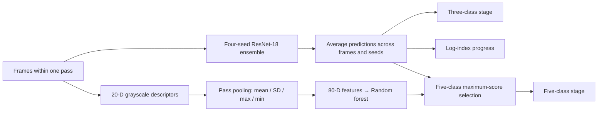

# PASS-Ord

### Visual stage recognition and operation-index progress estimation

[](LICENSE)
[](https://github.com/Timiocoisin/PASS-Ord/actions/workflows/verify.yml)

**A research implementation for turning fixed-camera grinding sequences into pass-level stage labels and a continuous operation-index estimate.**

PASS-Ord combines a four-seed ResNet-18 ensemble with a random forest trained on pass-pooled image descriptors. The implementation separates the three prediction tasks: the CNN ensemble supplies coarse stage classification and progress, while fine-grained stage classification selects between the CNN and RF outputs using a fixed maximum-score rule.

This repository provides the frozen inference component, retained experiment implementations, saved prediction records, and a lightweight verification workflow. The manuscript and submission materials are not part of this release.

## Architecture



The five-class selector compares each expert's largest class probability and uses the complete probability vector from the selected expert. Ties select the CNN. This is a fixed inference rule; the scores are not cross-model calibrated estimates of correctness. BiLSTM implementations are retained for baseline and ablation experiments and do not participate in this inference graph.

## Start with retained-result verification

The default entry point checks saved predictions against the retained metric record. It does **not** download model weights, load a checkpoint, fit a model, or alter experiment outputs.

```bash
git clone https://github.com/Timiocoisin/PASS-Ord.git
cd PASS-Ord
python -m venv .venv
# Linux / macOS
source .venv/bin/activate
# Windows PowerShell: .venv\Scripts\Activate.ps1
python -m pip install -r requirements-evaluation.txt
python verify_retained_metrics.py
```

Successful verification ends with:

```text
PASS: retained metrics agree within 1e-7. No model was trained.
```

The verifier recomputes pass-level accuracy, mean absolute error, and Spearman correlation for PASS-Ord, its matched CNN ensemble, SVM, and frame-feature RF. It checks consistency with the stored record; it is not an independent rerun of the image-based experiment.

## Use the inference component

```python
import numpy as np
from training.passord import route_pass_predictions

# Synthetic example for two passes; class labels are zero-based.
cnn_p3 = np.array([[0.90, 0.08, 0.02], [0.05, 0.15, 0.80]])
cnn_p5 = np.array([[0.55, 0.30, 0.05, 0.05, 0.05],
                   [0.02, 0.03, 0.10, 0.15, 0.70]])
rf_p5 = np.array([[0.10, 0.75, 0.05, 0.05, 0.05],
                  [0.05, 0.05, 0.10, 0.20, 0.60]])
cnn_progress = np.array([0.21, 0.87])

prediction = route_pass_predictions(cnn_p3, cnn_p5, cnn_progress, rf_p5)
assert prediction["pred_cls5"].tolist() == [1, 4]
```

Inputs must describe the **same passes in the same order**. Average CNN class probabilities and progress estimates over frames within each pass and over the four models before invoking the selector. RF probabilities must use the same five-class column order. The component validates array shapes, finite values, and normalized class probabilities.

## Protocol and target definitions

The retained study contains one laboratory specimen trajectory: 169 logged stages, 17,511 frames, and 877 passes. Targets are derived from the operation log:

| Output | Definition |
|---|---|
| Three-class stage | Early: 1–40; mid: 41–110; late: 111–169 |
| Five-class stage | `floor((g - 1) / 34)`, with labels 0–4 |
| Progress | `g / 169` |

Odd stages form the held-out test set. Even stages are divided into fitting stages (`g % 4 == 0`) and validation stages (`g % 4 == 2`), followed by refitting on all even stages. The test set comprises 85 stages and 441 passes.

Stages remain intact, but adjacent stages may belong to different partitions. The protocol therefore evaluates interpolation along one specimen trajectory. The progress target is an operation index, not a measurement of wall thickness or removed material.

## Repository map

```text
PASS-Ord/
├── training/                    # Reusable components and retained experiment code
│   ├── passord.py               # Frozen task-specific inference rule
│   ├── models.py                # ResNet architecture helper
│   ├── data.py                  # Frame dataset and preprocessing
│   ├── features.py              # Feature-cache loader
│   ├── labels.py                # Log-derived target definitions
│   ├── metrics.py               # Evaluation helpers
│   └── ...                     # Historical training / analysis implementations
├── evidence/
│   ├── predictions/            # Saved paired and CNN-only pass predictions
│   ├── classical_nested/       # SVM / RF configurations and predictions
│   ├── splits/                 # Portable frame and pass manifests
│   └── tables/                 # Retained result tables
├── logs/                       # Selected historical nested-protocol logs
├── tests/                      # Inference-contract checks
├── docs/                       # Release scope and experiment provenance
└── verify_retained_metrics.py
```

## Model and training code

Install `requirements-models.txt` to use the PyTorch and scikit-learn components. The dependency lists describe component requirements, rather than an exact reconstruction of the historical CNN environment. `training.models` requests ImageNet weights when constructing the pretrained backbone and may download them.

Historical scripts preserve the experiment implementations and their original output conventions. They are not a single supported command for reconstructing the final system. Some train models or overwrite derived artifacts. Consult [the code guide](training/README.md) and [the reproducibility notes](docs/REPRODUCIBILITY.md) before running them. Legacy filenames containing `sota` are historical identifiers, not a claim of field-wide superiority.

## Release scope

- **Included:** research code, portable split manifests, selected logs, checkpoint metadata, saved predictions, and numerical result tables.
- **Not included:** manuscript sources or PDFs, publication figures, author profiles, submission correspondence, raw acquisition images, feature-cache binaries, or model checkpoints.
- **Supported now:** frozen-rule reuse and verification of retained prediction metrics.
- **Not established by this release:** complete from-scratch training reproducibility or cross-specimen generalization. Separate historical four-seed launch arguments and the complete training environment were not retained.

The strongest three-class and progress outputs are inherited from the CNN ensemble. In the retained test predictions, the RF selector changes only five-class decisions. Read the saved paired records and uncertainty estimates alongside aggregate scores; this repository does not claim SOTA or statistically significant classification superiority.

## License

Source code authored for this project is released under the [MIT License](LICENSE). Numeric evidence and retained logs are supplied for research verification; they are outside the code-license grant. See [DATA_NOTICE.md](DATA_NOTICE.md). Third-party libraries retain their own licenses.

## Research status

The accompanying manuscript is not included, and this repository makes no claim of peer-reviewed publication or journal acceptance. No publication identifier is assigned here. Use the repository URL and a specific commit hash when referencing this implementation.
